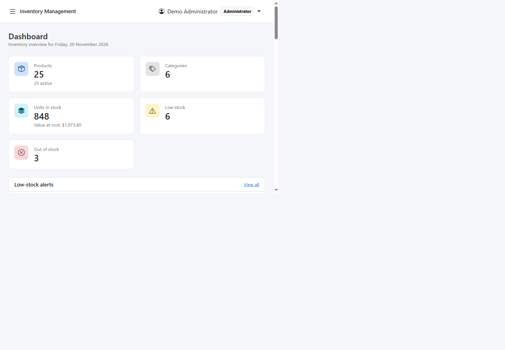
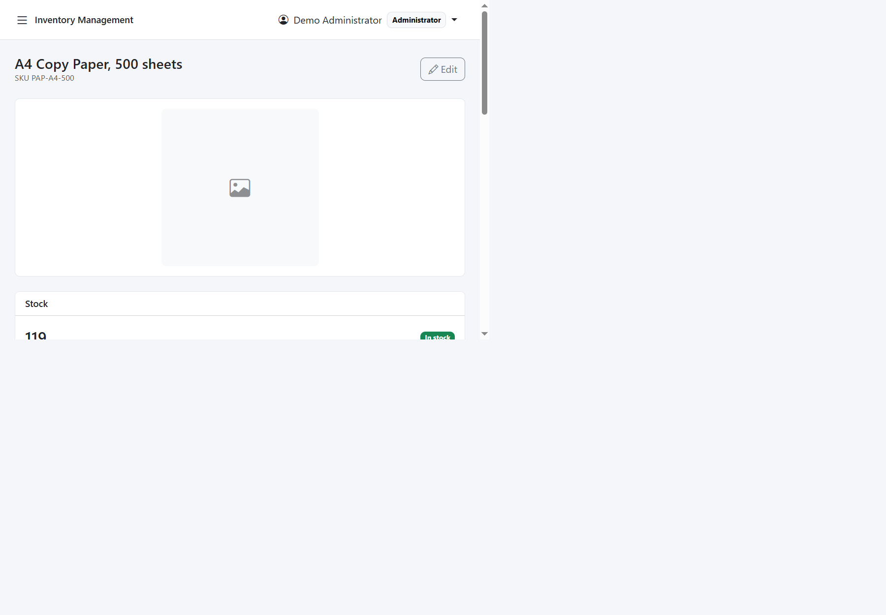
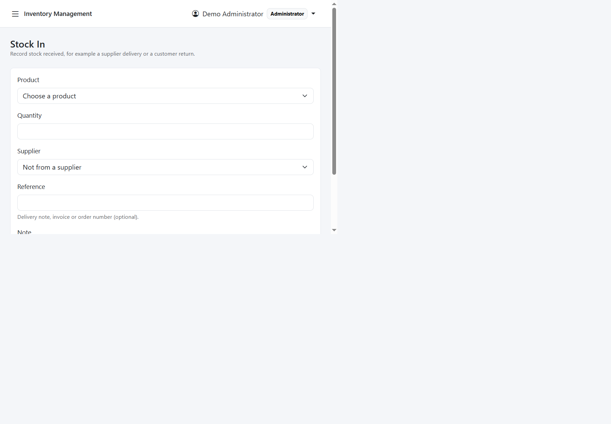
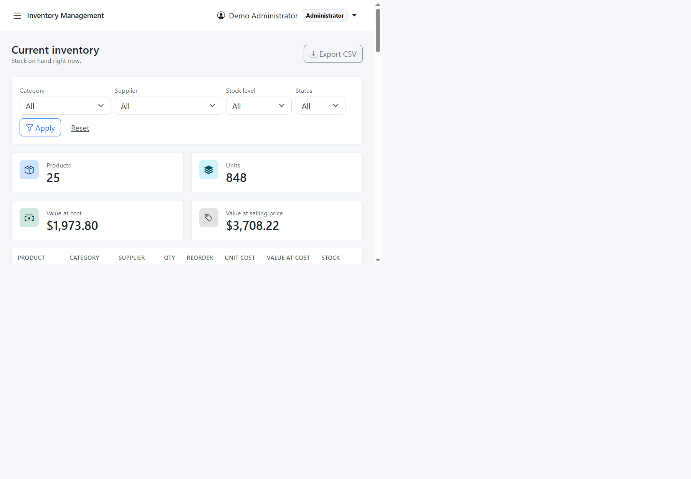
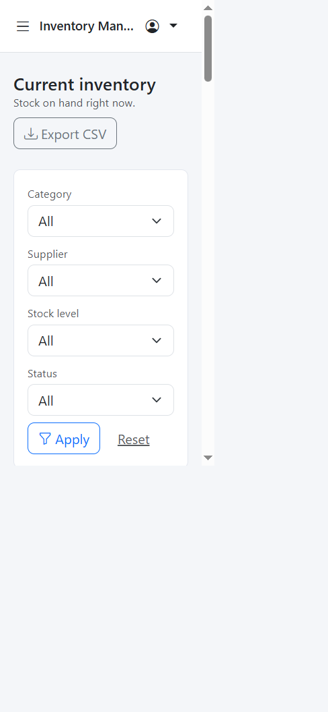
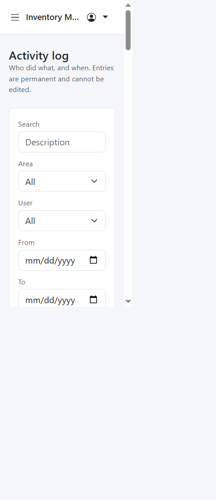
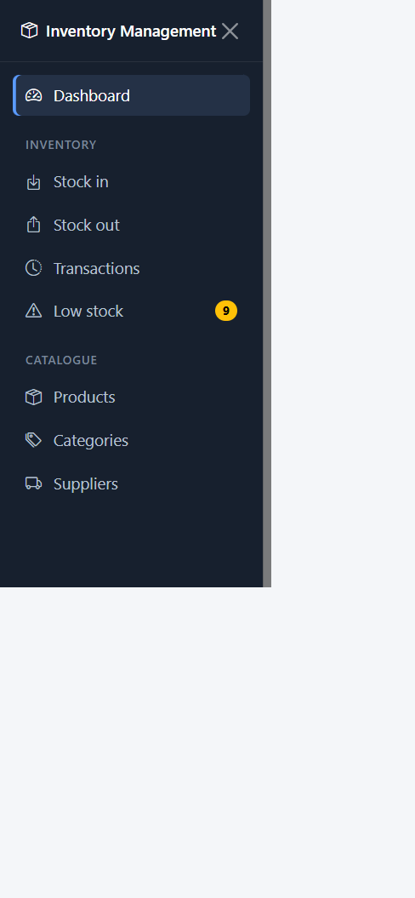
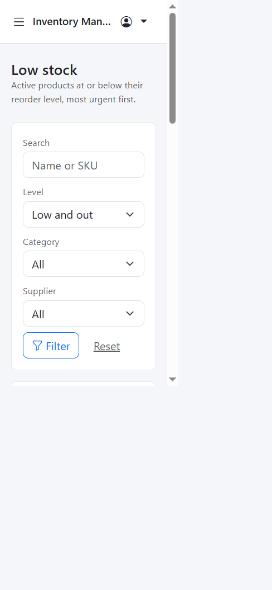
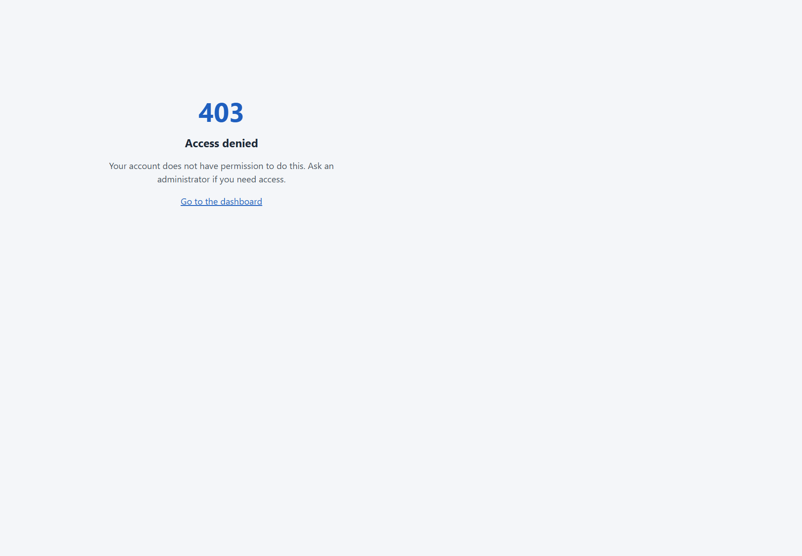

# Inventory Management System — Visual QA Report

## Summary

Manual browser QA covered the Admin and Staff experiences, guest authentication screens, core stock workflows, reports, and responsive layouts. Three genuine presentation issues were corrected without changing business logic or server-side access rules:

- Product details no longer offer deletion when stock history makes deletion unavailable.
- The low-stock and activity-log cards now contain their wide tables on narrow screens; the tables remain horizontally scrollable inside their own wrappers.

No known UI defects remain from the checked routes and viewports.

## Coverage

### Roles and routes

- **Admin:** 28 authenticated routes were opened at desktop (1440px), tablet (768px), and mobile (390px and 320px): dashboard, profile, product/category/supplier listing and management pages, stock history and operations, transaction detail, low stock, all report pages, activity log, and user management. All returned the expected page.
- **Staff:** 29 direct-route checks covered permitted pages and restricted routes. Dashboard, profile, product management, category/supplier browsing, stock-in/out, transaction history, and low stock were accessible. Category/supplier management, adjustments, reports, activity, and user management returned the styled 403 page. Ten permitted pages were also checked at 768px, 390px, and 320px.
- **Guest:** Login, invalid-credentials feedback, forgot-password, and reset-password form screens were inspected.

### Visual and functional checks

- Sidebar/navigation, profile menu, mobile sidebar open/close, buttons, forms, tables, dropdowns, empty search results, and validation/error messages.
- Admin and Staff stock-in/out workflows; Admin adjustment workflow. Stock operations were performed only against an isolated, seeded SQLite QA database. Quantities were restored to their starting value. An out-of-stock stock-out attempt displayed the expected guard message.
- Report filters and CSV output. The inventory CSV response was `200 text/csv`, included an attachment filename, and its header and 25 data rows were inspected in the browser.
- Staff navigation and direct-route authorization; Admin-only actions are not offered to Staff.
- Desktop, tablet, and phone widths. After fixes, tested pages had no document-level horizontal overflow. Wide tables scroll inside their responsive wrappers.

## Issues found and fixes

| Issue | Resolution |
|---|---|
| Product detail exposed a Delete action even when stock history prevented deletion. | Hide the impossible action and show the existing server guidance instead. Added a focused feature test; deletion rules are unchanged. |
| Low-stock table expanded the document on narrow screens despite its responsive table wrapper. | Added overflow containment to the table card; verified at 390px and 320px. |
| Activity-log table similarly expanded the document on narrow screens. | Added overflow containment to its table card; verified at 1440px, 768px, 390px, and 320px. |

## Screenshots

Screenshots show the post-fix UI. Desktop captures are 1800×1250 image pixels; phone captures are 488px wide.

| Page/state | Screenshot |
|---|---|
| Admin dashboard |  |
| Product with stock history and unavailable deletion |  |
| Admin stock-in form |  |
| Admin inventory report — desktop |  |
| Admin inventory report — phone |  |
| Admin activity log — phone |  |
| Staff mobile navigation |  |
| Staff low-stock — phone |  |
| Staff restricted page |  |
| Guest login and invalid-credentials state | [Login](login-desktop.png) · [Invalid credentials](login-invalid-credentials.png) |
| Guest password recovery | [Request reset link](password-reset-request.png) · [Choose new password](password-reset-form.png) |

## Automated tests

Full Laravel suite, run after the final UI fix: **171 passed, 693 assertions**.

## Limitations

- Password-reset form rendering was inspected, but outbound email delivery and completing a reset with a real token were not tested.
- QA used the local browser and isolated seeded database; physical devices and other browser engines were not covered.
- The browser download response and CSV body were verified, but the harness did not reliably retain the attachment as a local downloaded file.
